# Routine Manager

A personal Android app for a phone that sits on a stand all day as a dashboard.

- **Landscape:** a big clock and the current part of your daily routine on the left, four lists on the right.
- **Portrait:** the lists only, full width.

The routine repeats every week. When a new part of the day starts, the app plays a short tone. Everything stays on the phone: no account, no internet, no notifications.

It was built for one person and one phone (Samsung Galaxy A07, Android 16) and is installed by hand, not from Google Play. It needs Android 12 or newer; other phones are untested.

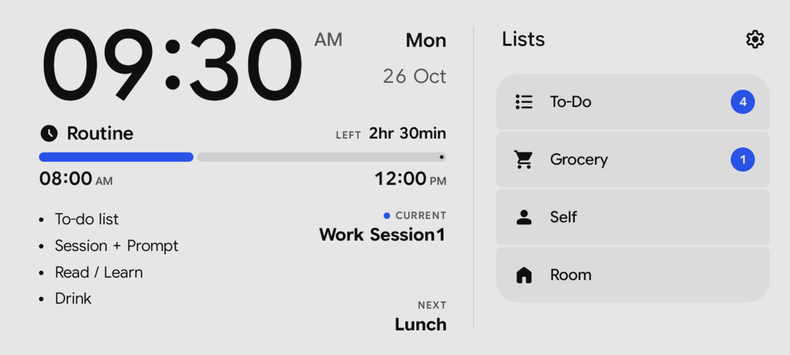

## Contents

- [Try it in your browser](#try-it-in-your-browser)
- [Feature walkthrough](#feature-walkthrough)
- [Important details](#important-details)
- [How the browser demo differs from the app](#how-the-browser-demo-differs-from-the-app)
- [Install](#install)

## Try it in your browser

**[Open the demo](https://mecha-coder.github.io/Routine-Manager/design/prototype/Routine%20Dashboard.dc.html)**

The demo is the HTML prototype the app was designed from. It behaves like the app, with a few differences ([listed below](#how-the-browser-demo-differs-from-the-app)).

- It needs internet: React, Babel and the fonts load from public CDNs.
- Chrome works best. It scales to fit the window, so it also runs in a phone's browser.
- A **TEST bar** at the top, which the real app doesn't have, lets you look around:
  - **Landscape / Portrait** switches the layout.
  - **Live** follows the real clock. The **Mon–Sun** buttons and the **time slider** jump to any minute of the week.
  - **Pause / 1× / 60× / 600×** sets how fast the demo's clock runs.
  - **Reset data** brings back the sample routine and lists.
- Your changes are saved in that browser only.
- Browsers only play sound after you've clicked the page once.

To run it without GitHub Pages: download [`Routine Dashboard.dc.html`](design/prototype/Routine%20Dashboard.dc.html) and [`support.js`](design/prototype/support.js) (on each file's page, use the **Download raw file** button), put both files in the same folder, and open the HTML file in Chrome. It still needs internet.

## Feature walkthrough

The screenshots come from the phone, using the app's sample data.

### 1. Dashboard: the current block

In landscape, the left side shows what you should be doing now.

- The clock, always 12-hour (`09:30 AM`), with the day and date on the right.
- **Routine** and **LEFT**: the time left in the current block, rounded up to the minute (`2hr 30min`).
- A progress bar from the block's start time to its end time.
- Up to five **sub-routines**, the steps of this block.
- **CURRENT**: this block's name. **NEXT**: the next block today, or `-` when it is the last one.

The screen redraws once a minute, on the minute.

See the screenshot at the top: Monday 9:30 AM, in the sample's "Work Session1" block (8:00 AM to 12:00 PM).

### 2. Free time

Between two blocks, the dashboard shows **Free time**, from the end of one block to the start of the next. It has no sub-routines and plays no tone.

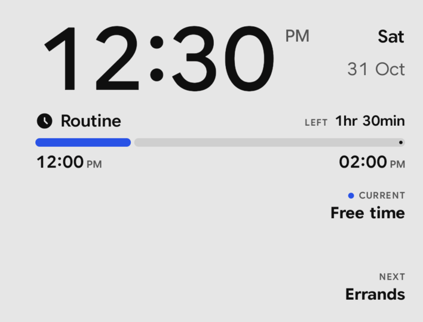

### 3. Bedtime and night dimming

Before the day's first block and after its last one, the dashboard says **Bedtime, see you tomorrow**.

- When the day's last block ends, the tone plays once more, so the end of the day is marked too.
- The screen dims to a low, fixed brightness and switches to the dark colours, whatever the theme setting says.
- To use the app at night, tap once: the first tap only brightens the screen and does nothing else, so you can't tick a to-do by accident.
- 30 seconds after your last touch it dims again.
- When the first block of the day starts, the normal brightness and your theme come back.
- A day with no blocks at all is Bedtime all day.

The dimming itself can't be seen in a screenshot; the dark colours can:

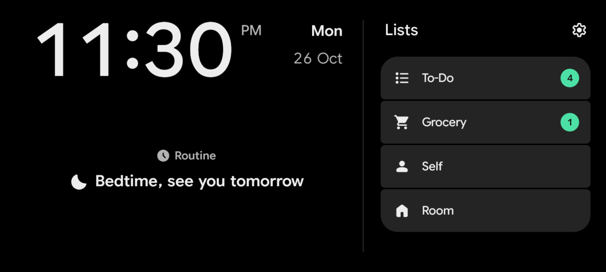

### 4. Lists and badges

The right side of the dashboard is a menu of four lists. Tapping one opens it in place of the menu; the clock stays on the left. The back arrow, or the phone's Back button, returns to the menu.

- **To-Do** shows how many items are not done yet, children included.
- **Grocery** shows how many items are selected ("need to buy").
- **Self** and **Room** have no badge.

A badge is blue (green in the dark theme) when its count is above zero.

### 5. To-Do, Self and Room

These three lists are numbered outlines: `1)`, `2)`, and one level of children, `2.1)`, `2.2)`.

- **To-Do:** tap an item to mark it done (struck through, grey). It stays in place; tap it again to undo.
- **Self** and **Room:** plain lists. Tapping an item does nothing.

Tap the pencil to edit. Each row gets a drag handle, a text field and a ✕.

- Enter (the keyboard's →| key) adds a new item right after this one and its children, and moves the cursor there.
- Backspace in an empty item deletes it. ✕ always deletes.
- Deleting a parent makes its children top-level items.
- **+ Add task** (To-Do) or **+ Add item** adds an item at the end.
- Tap the round ✓ button when you're done. Empty items are removed when you leave edit mode or the list.

When a list is empty it says "Nothing here. Tap ✎ to add."

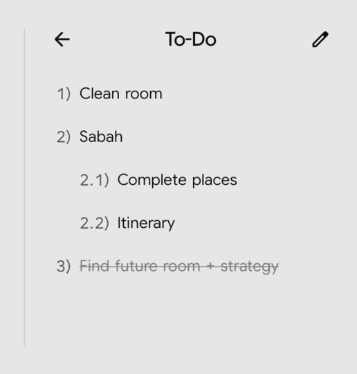 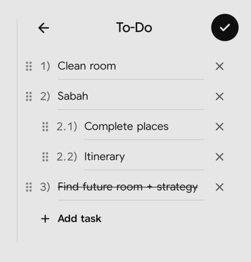

### 6. Drag to indent and reorder

In edit mode, the six-dot handle at the start of each row moves items:

- **Indent:** drag the handle sideways. Right makes the item a child of the item above it; left makes it a top-level item again. The row snaps to the nearest level when you let go. There is only one level of children, and the first item can't be indented.
- **Reorder:** press and hold the handle for about a third of a second. The phone gives a short buzz and the item lifts as a card. Drag it up or down; the other rows slide apart to show where it will land. A parent moves together with its children ("+2 sub-tasks" on the card).
- **Scroll:** swiping up or down on a handle scrolls the list instead.

The list doesn't scroll by itself while you drag, so to move an item further than the screen shows, drag it in steps and scroll in between.

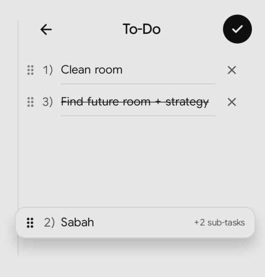

### 7. Grocery

Grocery is grouped into categories.

- Tap an item to select it: a filled dot and **bold** text mean "need to buy". Tap again to clear it.
- Each category header shows how many of its items are selected.
- Tap a category header to collapse or expand it. The app remembers this.

In edit mode:

- Rename a category in its name field; the bin icon deletes the category with all its items.
- Each item has a text field and a ✕. Enter and Backspace work as in To-Do.
- **+ Add item** under each category, and **+ Add category** at the end.
- When you leave edit mode, names are trimmed, empty items are removed, empty categories without a name are removed, and a nameless category that still has items is called "Untitled".

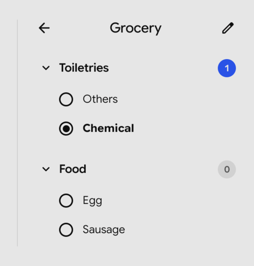 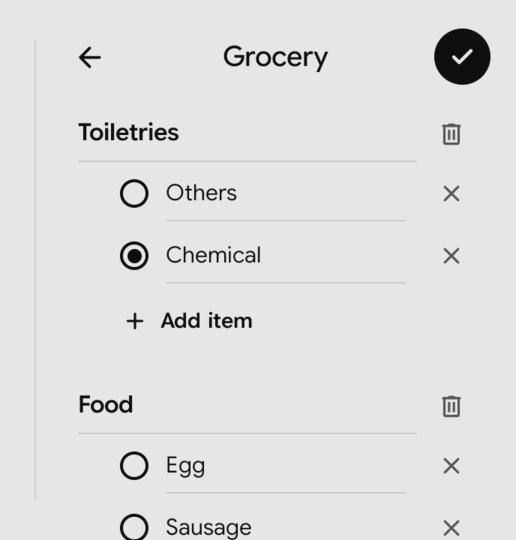

### 8. Settings

The gear icon next to "Lists" opens Settings.

- **Theme:** Light or Dark.
- **Weekly timetable:** opens the timetable (next step).
- **Block-change sound:** choose the tone that plays when a block starts. Tapping a row selects it and plays it.
  - **Marimba**: wooden notes, rising (about 2 seconds).
  - **Soft chime**: gentle bell notes (about 10 seconds). This is the default.
  - **Steel drum**: a bright two-note ping (about 2 seconds).
- **Volume:** how loud the tone is, 0–100 %. Only this slider sets it: the phone's volume buttons don't change it. Moving it while a tone plays changes it at once.
- **Sound or Vibrate:** tap the speaker icon at the start of the volume row to switch. In **Vibrate** mode the icon shows a vibrating phone, a block start vibrates the phone instead of playing the tone, and the volume slider is greyed out. Use it when a sound would disturb people, for example in an office, without silencing your whole phone. Tap the icon again to go back to the tone. Tapping a tone row still plays that tone.
- **Preview sound** plays the selected tone; it turns into **Stop** while playing. In Vibrate mode it is **Preview vibration**.

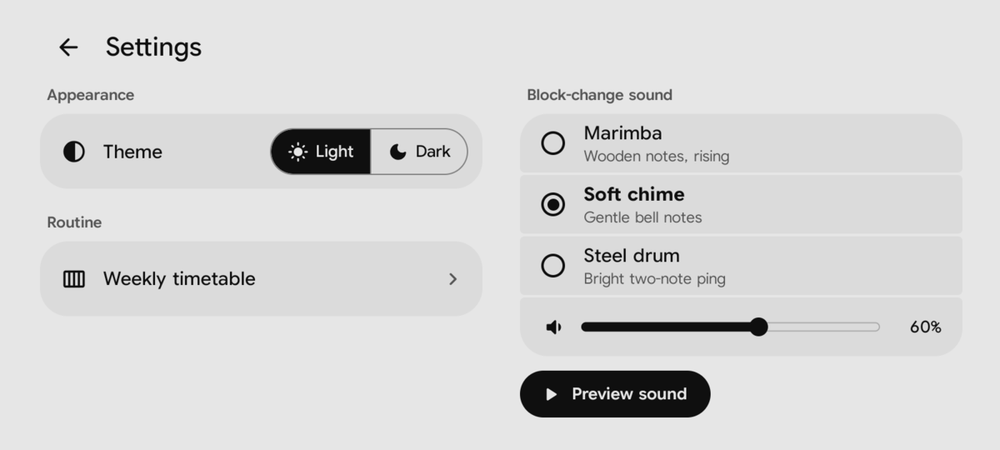

### 9. Weekly timetable

Settings → Weekly timetable shows the whole week.

- Seven day columns, Monday to Sunday; today's day is highlighted at the top and its column is shaded.
- Each block shows its name and time (`8:00am-12:00pm`). The block you're in now is coloured.
- A line with a dot marks the current time and moves every minute.
- It opens scrolled to about an hour and a half before now.

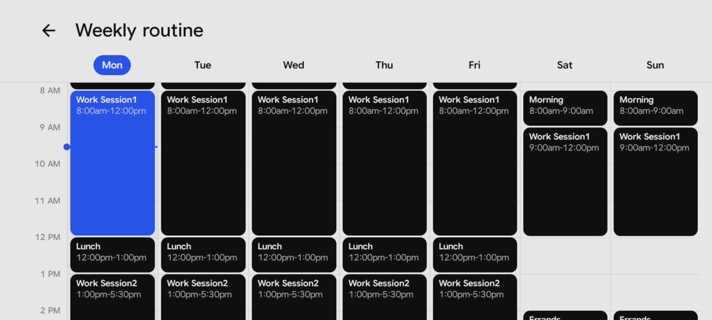

### 10. Creating a block in the timetable

- Press and hold an empty time for about a third of a second, until a short buzz.
- Without lifting your finger, drag up or down. The new block snaps to 15-minute steps and can't run into the blocks around it. A dashed outline shows its time.
- Let go to open the block editor with that day and time. A plain hold without dragging gives a one-hour block (shorter if the next block starts sooner).
- A normal swipe still scrolls the timetable.

Tap an existing block to edit or delete it.

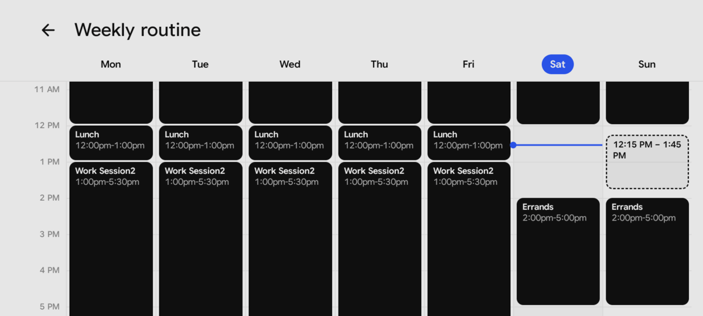

### 11. Block editor

- **Title**, and the **days** it repeats on (M T W T F S S, any number of them).
- **Start** and **End** wheels: hour, minute in 15-minute steps, and am/pm. Scroll or tap a value. An end of `12:00 am` means midnight, the end of the day. Moving Start to or past End pushes End to one hour after Start.
- **Sub-routines:** up to five steps. Enter adds the next one; Backspace in an empty one removes it. "+ Add sub-routine" disappears at five.
- **Save** checks, in this order, and shows the first problem:
  - `Give the block a title.`
  - `End time must be after the start time.`
  - `Pick at least one day.`
  - an overlap with another block on one of the chosen days, for example `Overlaps “Commute” (7 AM – 8 AM) on Mon, Tue.`
- **Delete** (only when editing) removes the block. ✕ or Back closes the editor without saving.
- When the editor doesn't fit on the screen (with an error line, or with the keyboard open), it scrolls.

A block saved for several days is one block shown on each of those days: editing any day's copy changes all of them, unticking a day removes that day's copy, and Delete removes it from every day.

Changes show on the dashboard at once. If you create a block that covers the current time, its tone plays.

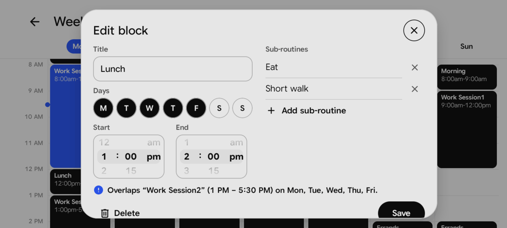

### 12. Portrait

Turn the phone upright and the app shows only the lists, full width. Settings, the timetable and the editor work in portrait too. Turning the phone keeps everything as it was: the open list, edit mode, the text you're typing, an open editor.

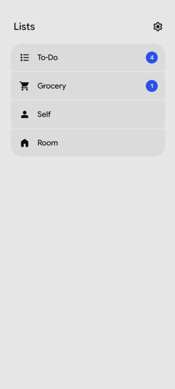

### 13. App icon

The launcher icon shows "07:05" above a progress bar. It follows the phone's dark mode, inverted so it stands out: a dark icon when the phone is in light mode, a light icon when it is in dark mode. (This image is drawn from the app's icon files, not taken from the phone.)

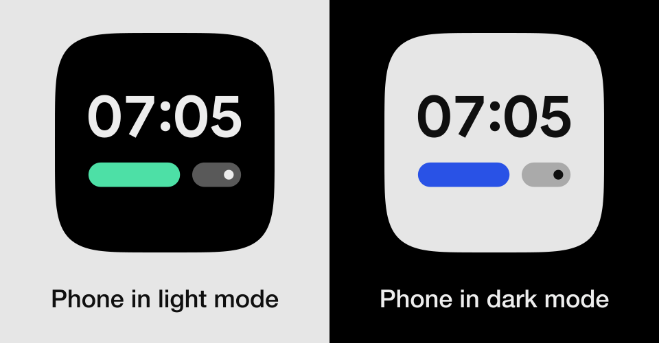

## Important details

- **The tone plays only while the app is on screen.** There are no alarms and nothing runs in the background. A block that starts while the app is hidden or the screen is off is not announced later, and opening the app doesn't play the tone for the block already running. Free time is silent; the start of Bedtime plays the tone (step 3).
- **Vibrate mode is felt in every phone sound mode**, including silent and Do Not Disturb, like the tone.
- **Only the app's volume slider sets how loud the tone is.** The tone uses the phone's alarm volume, which the app turns up to full just for the tone and then puts back. So the tone also sounds in silent mode and Do Not Disturb. Music or a podcast is turned down while it plays, then comes back. If the app is force-closed in the middle of a tone, the alarm volume stays at full; set it back in the phone's sound settings.
- **The screen stays on** while the app is open, plugged in or not.
- **Low battery:** below 15 % and not charging, the app stops keeping the screen on, so the phone's normal screen timeout applies. Plug in and the screen stays on again within a minute.
- **Bedtime** dims the screen and switches to the dark colours; the first tap only brightens it (step 3).
- **Rotation follows the phone, even with auto-rotate (rotation lock) off:** portrait, landscape, and landscape the other way round. Upside-down portrait is not used.
- **Full screen:** the status and navigation bars are hidden. Swipe in from the edge of the screen to see them for a moment. No text or button sits under the camera notch.
- **Your data lives only on this phone.** There is no cloud backup, no export and no sync. Uninstalling the app deletes everything, so update it by installing the new version over the old one ([INSTALL.md](docs/INSTALL.md)). Moving to a new phone with a phone-to-phone transfer tool (such as Samsung Smart Switch) may copy the data.
- **Saving is automatic,** half a second after your last change, and again when you leave the app.
- **After a restart** the app doesn't open by itself, and it isn't shown over the lock screen: unlock the phone and open it.
- **Midnight:** the date and the day's routine change at 12:00 AM. If you change the phone's time or time zone, the app updates at once.
- **The clock is always 12-hour,** whatever the phone's setting. The app is in English only.
- **Text size:** the layout is made for the phone's default font size. Larger system font sizes may cut text off.

## How the browser demo differs from the app

The demo is the design prototype ([design/README.md](design/README.md)). The app follows it, except where the owner decided otherwise ([docs/SPEC.md](docs/SPEC.md)).

| | Browser demo | Android app |
|---|---|---|
| Testing controls | TEST bar: layout switch, Live, day and time jump, clock speed, Reset data | None. The app follows the phone's rotation and the real clock. |
| Tones | Singing bowl, Soft chime, Warm pad, made live in the browser. Default: Singing bowl. | Marimba, Soft chime, Steel drum. Default: Soft chime. |
| Bedtime | The "Bedtime" message only | The message, plus the tone at its start, the dim screen, dark colours and tap-to-brighten |
| Screen on and low battery | Not applicable | Keeps the screen on; stops below 15 % when not charging |
| Screen | A drawn phone frame, scaled to fit the window | The phone's whole screen, keeping clear of the camera notch |
| Where data is saved | In that browser | On the phone only |
| Dark theme | A colour filter over the light design, close to the final colours | The final dark colours |
| App icon | None | "07:05" icon that follows the phone's dark mode |

## Install

The app is not on Google Play. [docs/INSTALL.md](docs/INSTALL.md) explains how to build it, install it on the phone with adb, and update it later without losing data.
